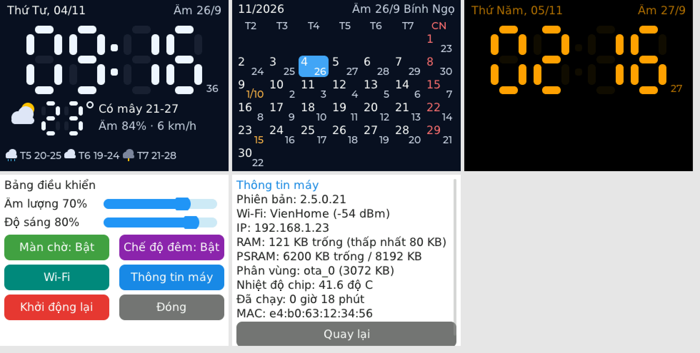

# Màn hình chính, chế độ đêm và bảng điều khiển (màn TFT 2,8")

Ảnh trên được dựng trên máy tính từ chính mã nguồn (font thật trên robot hơi khác).

## Màn hình chính
- Khi robot rảnh khoảng 15 giây (không nói chuyện, không có thông báo, không mở nhạc, không mở menu), màn hình chính hiện ra:
  - Đồng hồ số kiểu LED, thứ và ngày, ngày âm lịch.
  - Thời tiết hiện tại (Open-Meteo, không cần key): nhiệt độ, trời, nhiệt độ thấp-cao hôm nay, độ ẩm, gió, dự báo 3 ngày tới.
- Vuốt sang trái để xem **lịch tháng** có ngày âm (ngày mùng 1 ghi cả tháng âm, mùng 1 và rằm tô màu cam). Vuốt sang phải để quay lại đồng hồ.
- Chạm vào màn hình chính thì mở trò chuyện như trước. Nói "Xiao Zhi" cũng vậy.
- Đổi nơi xem thời tiết bằng giọng nói: "đổi thời tiết sang Hà Nội" (mặc định là Thanh Hóa). Hỏi "thời tiết hôm nay thế nào" thì robot đọc số liệu trên màn hình.

## Chế độ đêm
- Từ 22h đến 6h, màn hình chính chuyển sang đồng hồ màu hổ phách, tắt phần thời tiết và giảm đèn nền còn 5%.
- Chạm một lần để màn sáng lại trong 10 giây (lần chạm này không mở trò chuyện).
- Tắt chế độ đêm trong bảng điều khiển.

## Cử chỉ vuốt
- **Vuốt xuống**: mở bảng điều khiển (trên màn trò chuyện thì vuốt từ mép trên).
- **Vuốt lên**: mở menu (trên màn trò chuyện thì vuốt từ mép dưới).
- **Vuốt trái/phải**: đổi trang trên màn hình chính.

## Bảng điều khiển
- Thanh trượt âm lượng và độ sáng (được lưu lại).
- Bật/tắt màn hình chính, bật/tắt chế độ đêm.
- Wi-Fi (mở màn hình cài Wi-Fi), Thông tin máy (phiên bản, Wi-Fi, IP, RAM, PSRAM, phân vùng, nhiệt độ chip, thời gian chạy, MAC), Khởi động lại.
